# E-Wallet Bill Payment Success Rate Analysis

**Why did bill payments suddenly start failing on July 28, 2023, and what should the team fix first?**

---

## 1. Objective

### What is this project about?

This project analyzes why the **bill payment success rate** of an **E-Wallet** app dropped after **July 28, 2023**, and what the team should fix first. It uses a simulated dataset from **Jul 1 to Aug 31, 2023** (32,122 transactions, 49,675 sessions, 435,658 app events and 1,500 users). The analysis focuses on:

- **Success Rate Monitoring**: Comparing the success rate before (Jul 1–27) and after (Jul 28–Aug 31) to see when the drop started and how big it is.
- **Root Cause Analysis**: Breaking the drop down by transaction type, bill type, user group, app version, error type and app release to find what changed.
- **Recovery Plan**: Turning the findings into clear actions that bring the success rate back and catch the next drop earlier.

### Who is this project for?

This analysis is designed for the teams that own the bill payment flow of the E-Wallet app, including:

- **Product Manager**: To understand where users fail to pay bills and decide what to fix first.
- **Engineering Team**: To see which release, payment step and error types are behind the failures.
- **UX & Customer Support Team**: To know what users see when a payment fails and how to help them pay again.
- **Board of Directors (BOD)**: To get a short, clear view of how big the problem is and the recovery plan.

### Business Questions

- How much did the bill payment success rate drop, and when did it start?
- Did the drop hit all transaction types, or mainly bill payments?
- Which bill types, user groups, devices or app versions were affected?
- At which step of the payment flow do bills fail, and which errors grew the most?
- Is the drop linked to an app release or a system change?
- What should the team fix first, and how can it catch a similar drop earlier?

### Project Outcome

The project found where and why bill payments started to fail, and turned the findings into a recovery plan with five actions.

**Key Results:**

- Found the break point: the bill payment success rate fell from **89.9% to 72.7%** on **July 28, 2023**, the same day as app release v3.9.6, and three later releases did not bring it back.
- Showed that the problem sits in the bill payment flow, not in one user group: every bill type, platform, payment method and user group fell by about the same amount, while transfers, deposits and withdrawals did not change.
- Found the main cause: authentication errors explain about **three quarters** of the drop, mostly at the security check step (**3DS time-outs and expired OTP codes**). Users who did not update the app failed too, so the change was most likely on the server side.
- Proposed five actions: roll back the July 28 changes and re-launch them step by step, extend the OTP/3DS time limits, add safe auto-retry for gateway time-outs, show a clear failure screen with a 1-tap retry, and add a real-time success rate alert.

**Outcome:**

The project gives the product and engineering teams a clear answer to what broke and where to start, with a plan to bring the bill payment success rate back to its 89.9% baseline.

---

## 2. Design Thinking Process

Before looking at the data, the problem **"Billing success rate dropped"** was broken down with **5W1H** (What, When, Where, Who, Why, How). Each branch lists the questions to answer and the dimensions to check.

### What — what changed?

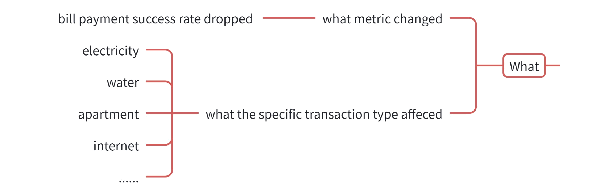

### When — when did it start?

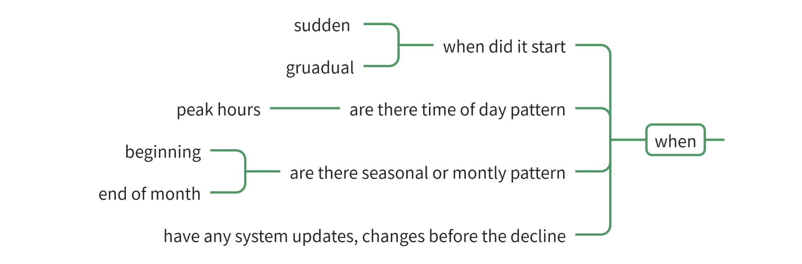

### Where — where does it happen?

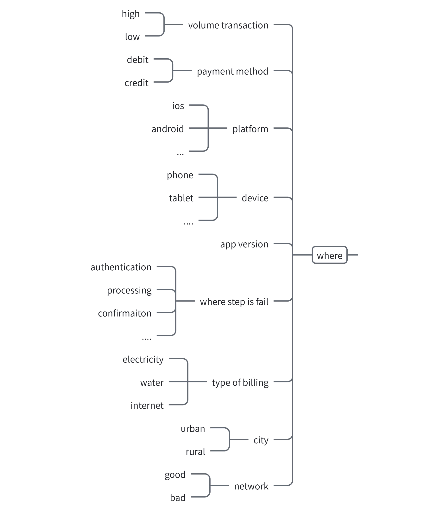

### Who — who is affected?

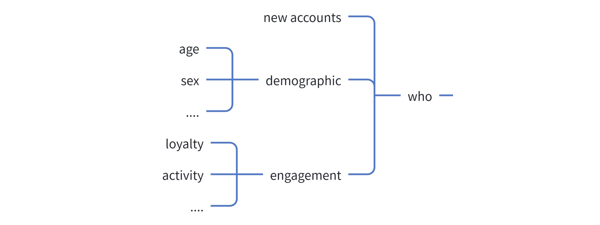

### Why — why did it happen?

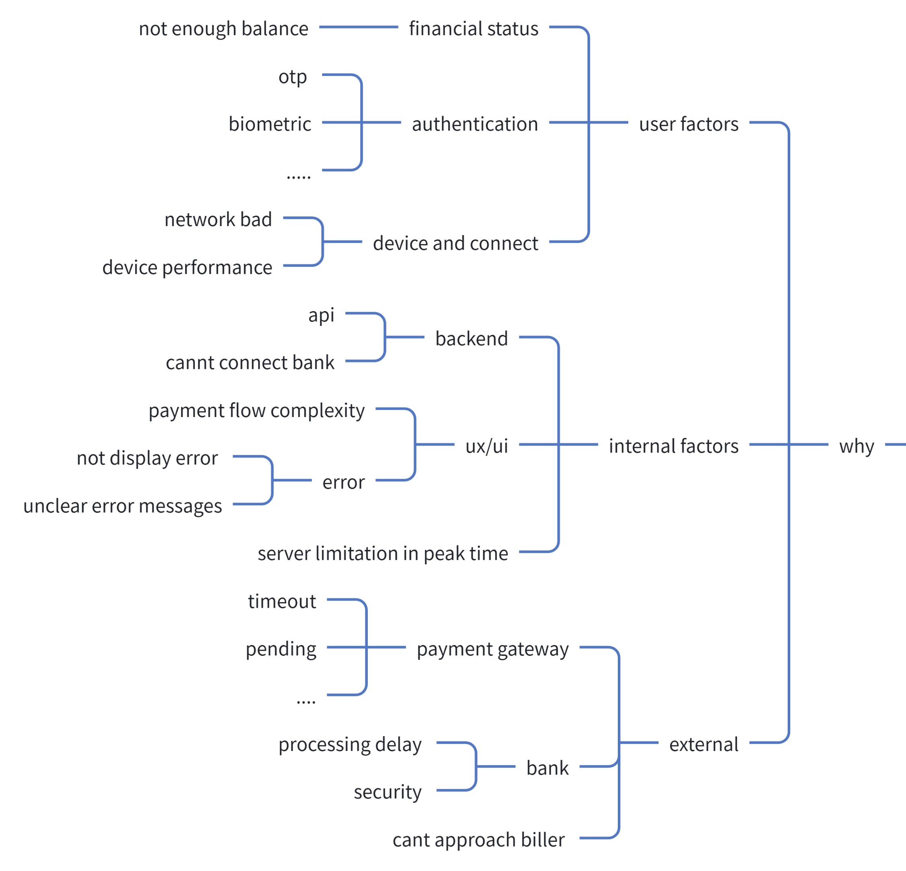

### How — how to find the answer?

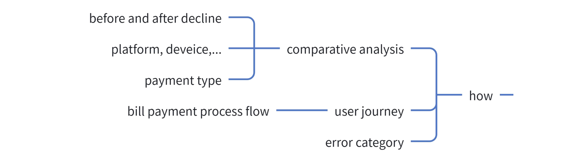

---

## 3. Insights & Recommendations

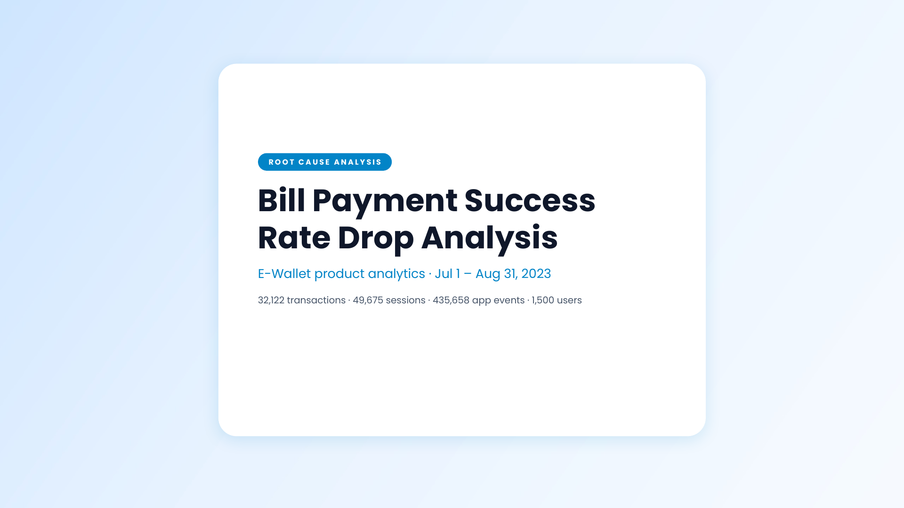

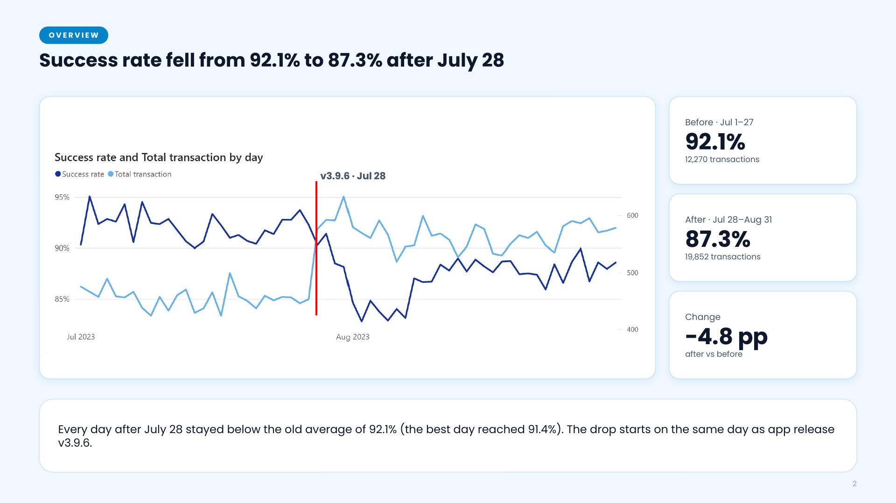

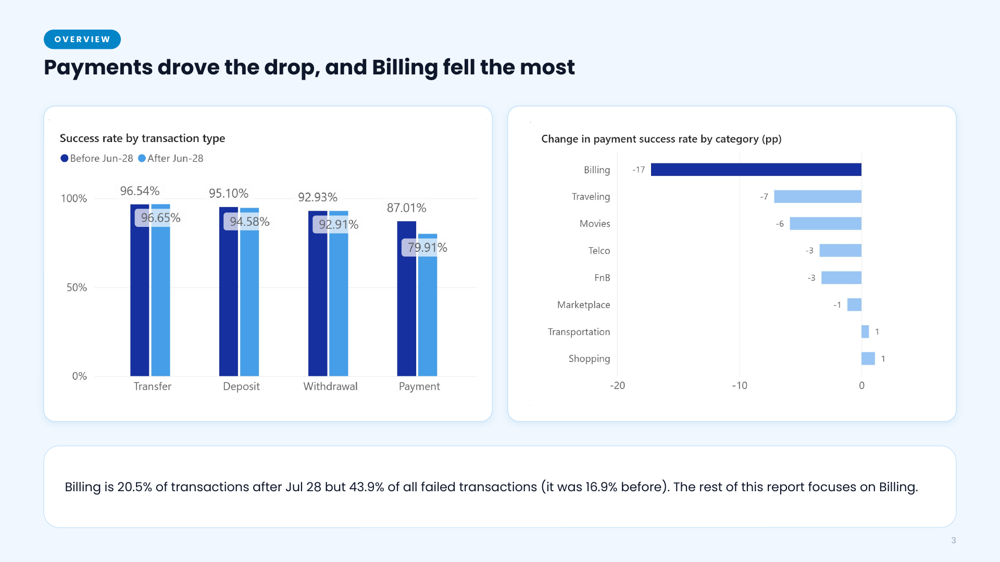

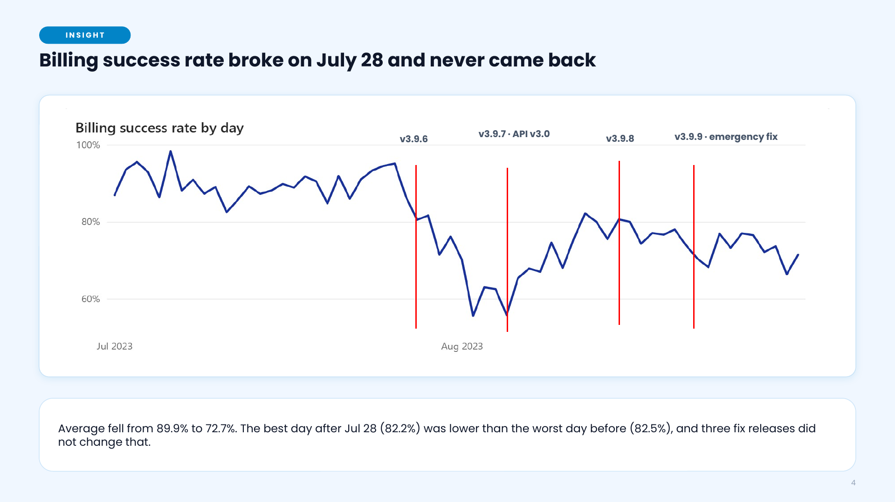

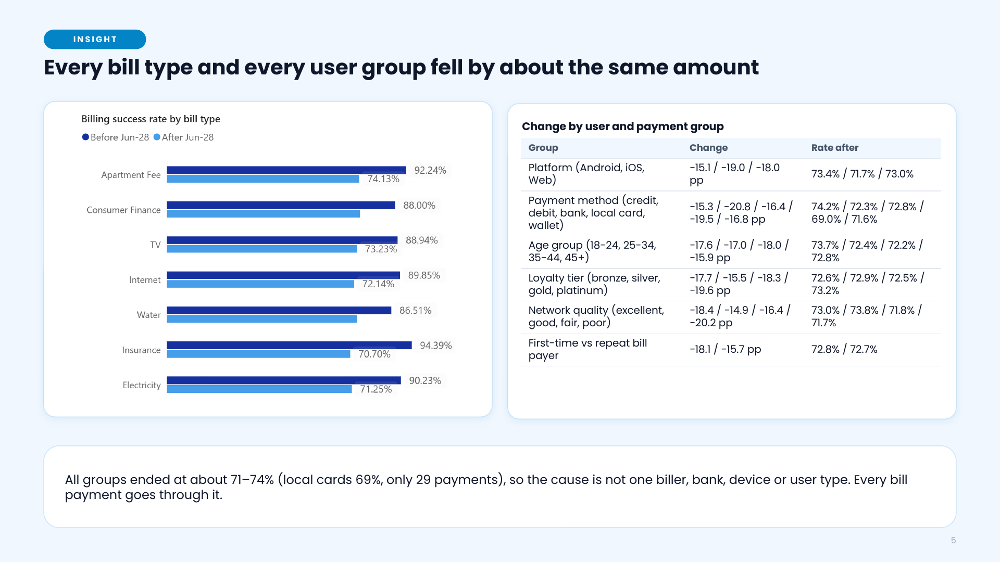

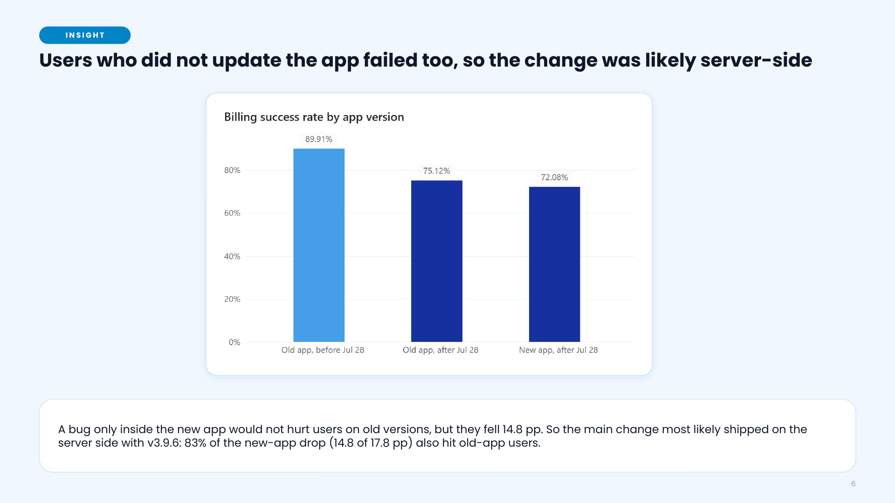

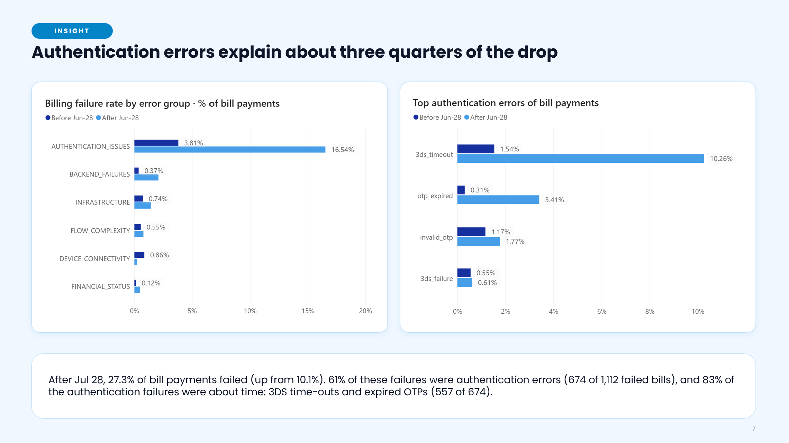

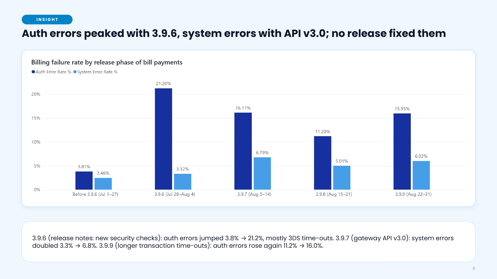

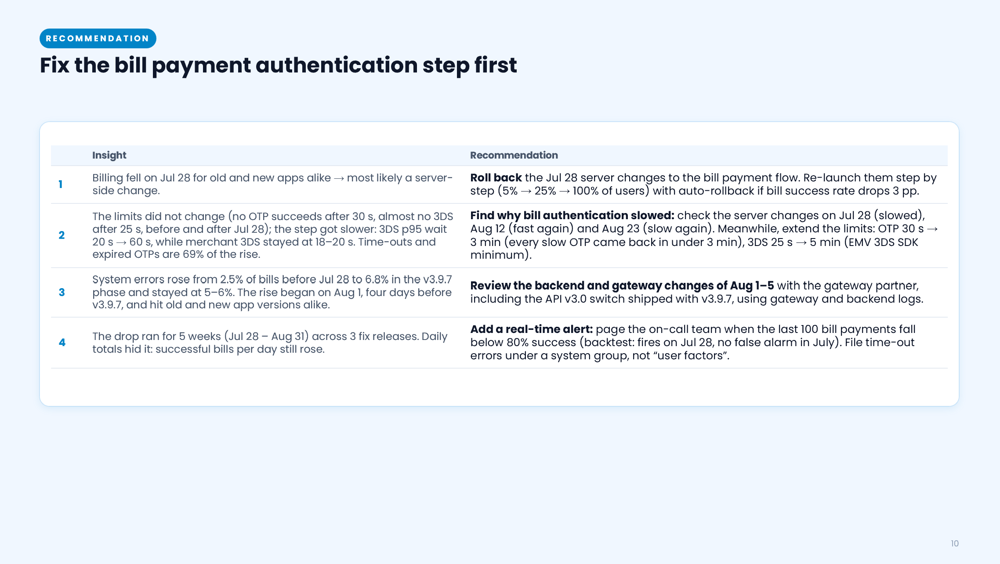
